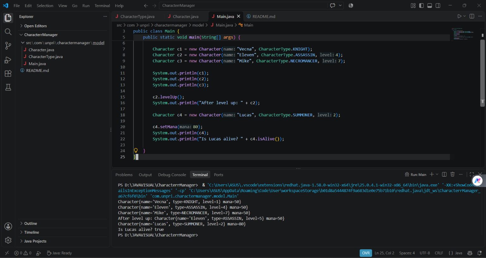

Character Manager — TP3 (Java Visual SIH-6406)
Program ini dibuat untuk mengelola karakter RPG sederhana menggunakan Java.

Program memiliki fitur level up, mana, serta pengecekan status hidup karakter menggunakan method isAlive().

Screenshot Output
()

Struktur Folder Project
CharacterrManager
│
├── README.md
└── src
    └── com
        └── unpri
            └── charactermanager
                └── model
                    ├── Character.java
                    ├── CharacterType.java
                    └── Main.java
Identitas
Nama : Karyn Natashia Siregar

NIM : 253303621220

Link Google Docs : ([text](../JavaVisual_TP03_[NIM]_[Nama].docx))
