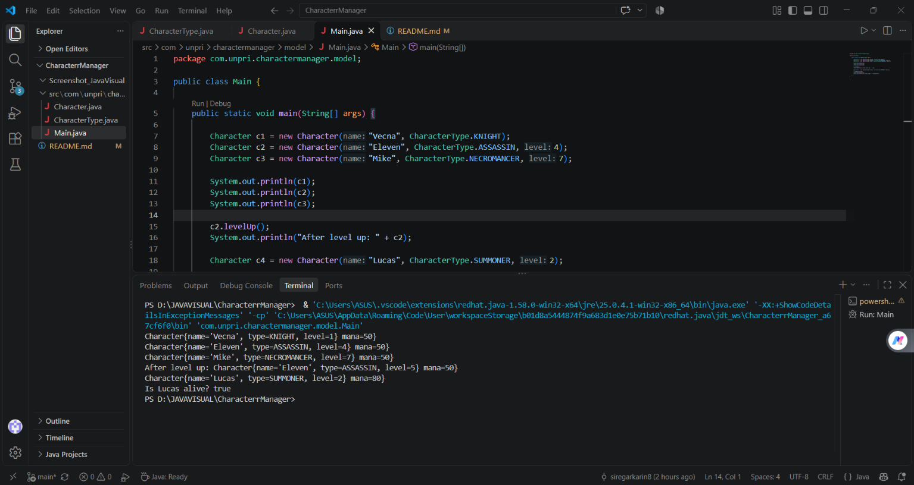
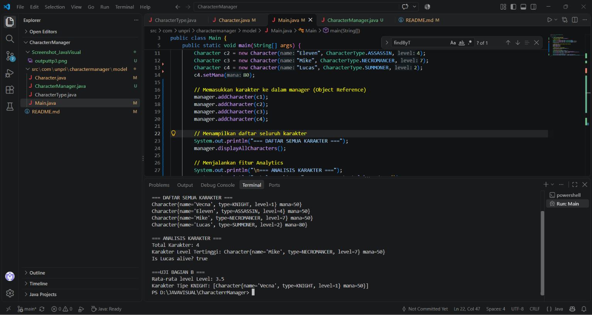
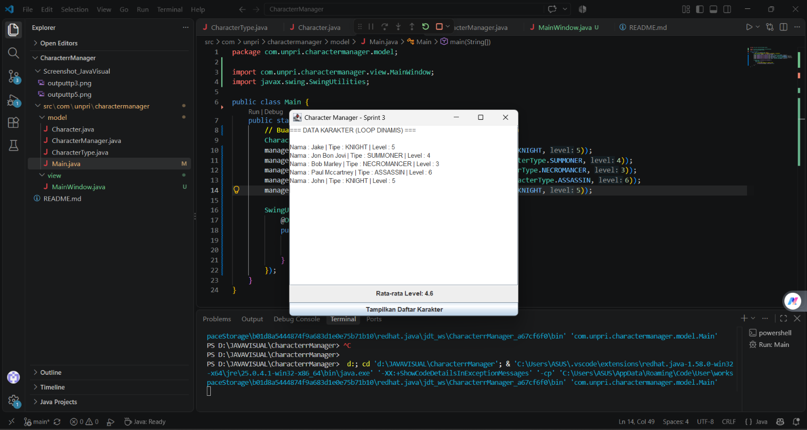
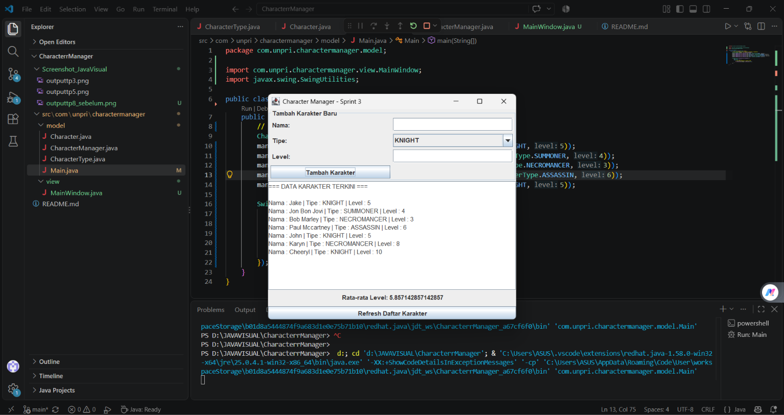

# Character Manager — TP3

**Mata Kuliah:** Java Visual  
**Kelas:** SIH-6406

## Deskripsi Program

Character Manager adalah program sederhana berbasis Java yang digunakan untuk mengelola karakter dalam permainan RPG (*Role-Playing Game*).

## Fitur Program

- **Level Up:** Meningkatkan level karakter.
- **Mana:** Mengelola nilai mana karakter.
- **Status Hidup:** Memeriksa apakah karakter masih hidup menggunakan method `isAlive()`.

## Screenshot Output



---

## Fitur Program TP5 (Terbaru)

- **Manajemen & Analisis (Bagian A & B):** Mencegah duplikat nama karakter menggunakan `equals()`, menghitung rata-rata level (`getAverageLevel()`), mencari karakter berdasarkan tipe (`findByType()`) dan level tertinggi (`getHighestLevelCharacter()`).
- **Fitur Analitik Tambahan (Bagian C):** Menghitung total karakter berdasarkan tipe tertentu (`countByType()`).

## Screenshot Output TP5



---

### Fitur Program TP8 

- **Implementasi GUI (Bagian A):** Antarmuka pengguna berbasis Java Swing menggunakan `MainWindow` dan `SwingUtilities.invokeLater()`.
- **Manajemen & Tampilan Dinamis (Bagian B):** Menambahkan minimal 5 karakter secara dinamis serta menampilkan perhitungan rata-rata level secara otomatis pada GUI.

## Screenshot Output TP8

1. Screenshot MainWindow (Minimal 5 Karakter + Statistik)



2. Penjelasan Aliran Data MVC (3-4 Kalimat)
Aliran data dimulai dari kelas `Main` yang berfungsi menginisialisasi objek `CharacterManager` serta memasukkan data karakter awal. Objek `CharacterManager` bertindak sebagai Model yang menyimpan dan mengelola kumpulan data karakter secara terpusat. Data tersebut kemudian dikirimkan ke kelas `MainWindow` yang berperan sebagai View melalui constructor untuk dirender ke antarmuka pengguna, termasuk menampilkan perhitungan statistik rata-rata level. Penerapan pola MVC ini memisahkan secara tegas antara logika pengelolaan data dengan tampilan visual aplikasi.

3. Daftar Karakter Baru & Alasan Pemilihan
* **Arthas (KNIGHT, Level 5)**: Dipilih untuk merepresentasikan peran petarung garis depan (*tank*) dengan tingkat level menengah yang stabil guna menjaga keseimbangan statistik rata-rata.
* **Jaina (SUMMONER, Level 4)**: Dipilih guna memberikan variasi kelas karakter pengguna sihir pemanggil dengan level penyeimbang di bawah ksatria.
* **Thrall (NECROMANCER, Level 3)**: Dipilih untuk menghadirkan variasi kelas magis kegelapan dengan tingkat level yang lebih rendah agar rentang data lebih bervariasi.
* **Sylvanas (ASSASSIN, Level 6)**: Dipilih sebagai representasi kelas penyerang cepat dengan level tertinggi untuk menguji fungsionalitas pencarian data level maksimum.
* **Uther (KNIGHT, Level 5)**: Dipilih sebagai ksatria tambahan untuk menguji keakuratan metode penghitungan jumlah karakter berdasarkan tipe yang sama (`countByType`).

---


## Struktur Folder Project

```text
CharacterrManager/
├── README.md
├── Screenshot_JavaVisual/
│   └── outputtp3.png
│   └── outputtp5.png
    └── outputtp8_sebelum.png
    └── outputtp8_sesudah.png
└── src/
    └── com/
        └── unpri/
            └── charactermanager/
                ├── model/
                │   ├── Character.java
                │   ├── CharacterType.java
                │   ├── CharacterManager.java
                │   └── Main.java
                └── view/
                    └── MainWindow.java
```

## Identitas Mahasiswa

**Nama:** Karyn Natashia Siregar

**NIM:** 253303621220

**Link Google Docs:** [Dokumen TP3](https://1drv.ms/w/c/EF681E4F4E3CE288/IQA3LqwMH3jhSJLam470mUvfASUPnESEdle9STdoZw2fhDc?e=EaE6bd)

**Link Google Docs:** [Dokumen TP5](https://1drv.ms/w/c/3F04BCD0705D5ACD/IQCLGfsidsMiQ6f3CYXbPwSnAcmlPmaHwItOcZx_zgjckoU?e=fP7UHj)

**Link Google Docs:** [Dokumen TP8](https://1drv.ms/w/c/3F04BCD0705D5ACD/IQDnqhN2Jpn4Rp3ahwA7BP03AS-uqR3VP1WR10uLFd25Tnc?e=pPrdza)


